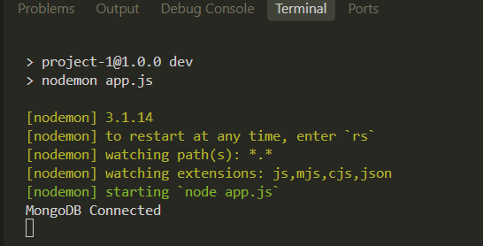
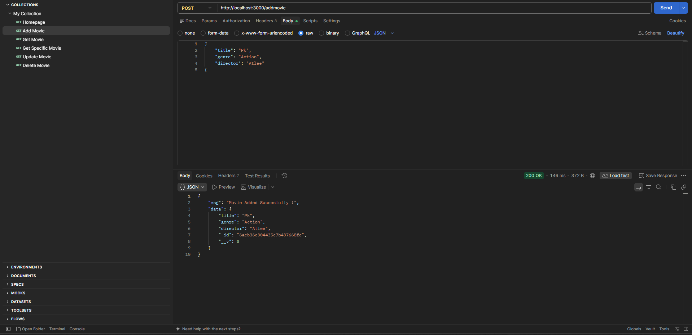
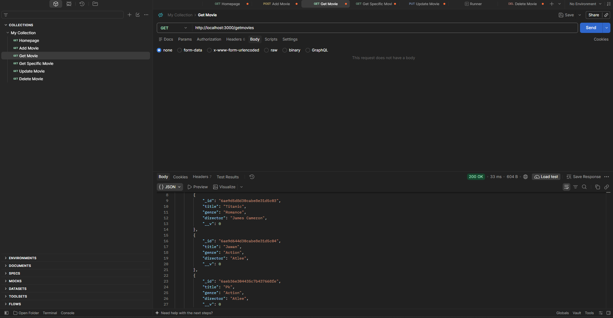
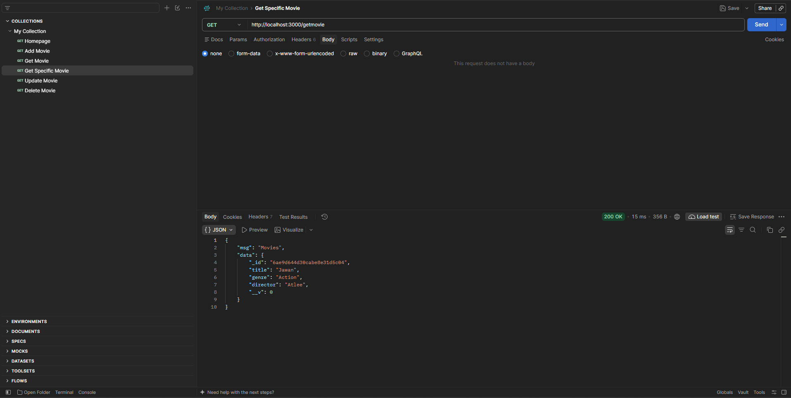
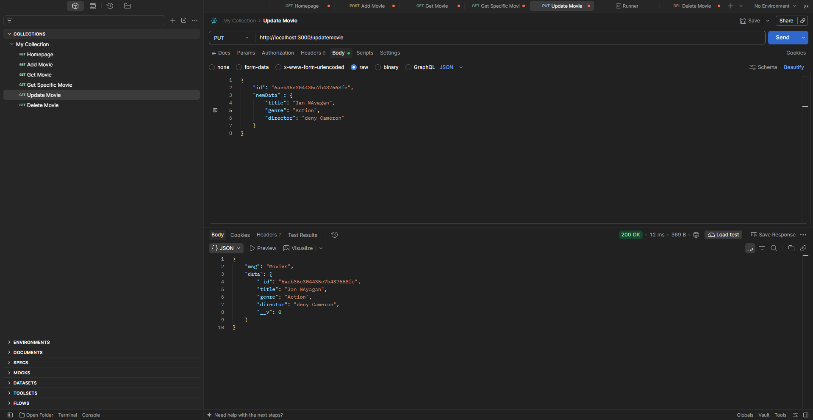
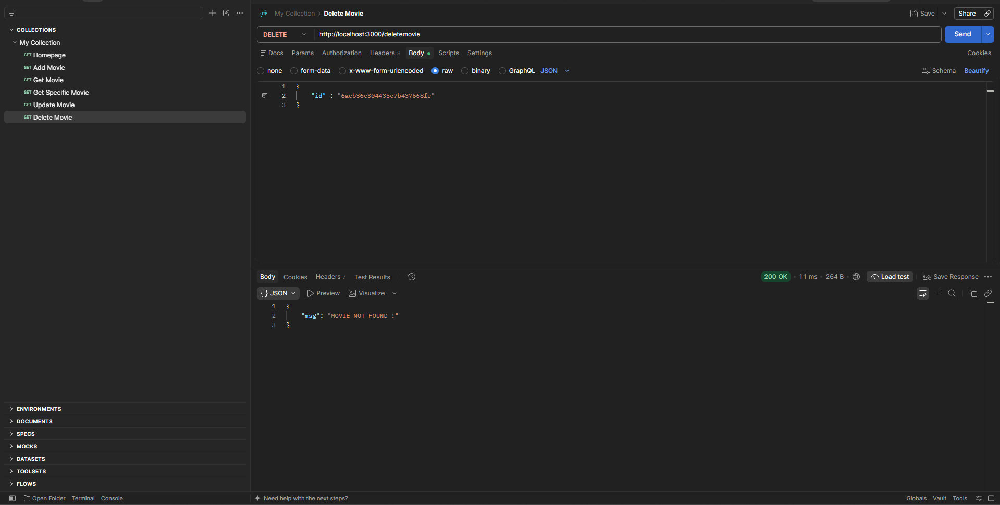
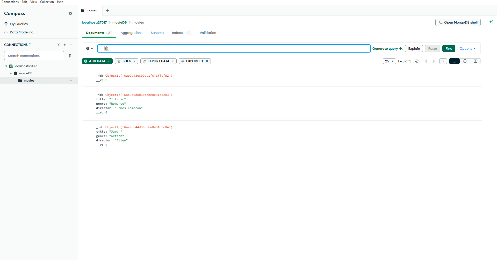

# Movie Management API

A simple REST API built with **Node.js**, **Express.js**, and
**MongoDB** using **Mongoose**. It allows you to add, view, update, and
delete movies.

## Project Structure

``` text
project-1/
├── node_modules/
├── app.js
├── package-lock.json
└── package.json
```

## Technologies Used

-   Node.js
-   Express.js
-   MongoDB
-   Mongoose

## Requirements

Make sure you have installed:

-   [Node.js](https://nodejs.org/)
-   [MongoDB Community
    Server](https://www.mongodb.com/try/download/community)

## Installation and Setup

1.  Open the project folder in VS Code.

2.  Open the terminal in the project folder.

3.  Install the required packages:

    ``` bash
    npm install express mongoose
    ```

4.  In `package.json`, add `"type": "module"` so that the `import`
    statements in `app.js` work. For example:

    ``` json
    {
      "type": "module",
      "scripts": {
        "start": "node app.js"
      },
      "dependencies": {
        "express": "^5.0.0",
        "mongoose": "^8.0.0"
      }
    }
    ```

    Keep the dependency versions generated by your own `npm install`;
    the versions above are only examples.

5.  Make sure the MongoDB server is running on your computer. This
    project connects to:

    ``` text
    mongodb://127.0.0.1:27017/movieDB
    ```

6.  Start the application:

    ``` bash
    npm start
    ```

    Or run it directly:

    ``` bash
    node app.js
    ```

7.  Open the home route in your browser:

    ``` text
    http://localhost:3000/
    ```

The database named `movieDB` and the `movies` collection are created by
MongoDB/Mongoose when data is first stored.

## API Routes

Base URL: `http://localhost:3000`

  Method   Endpoint         Description
  -------- ---------------- -------------------------------------
  GET      `/`              Check the home route
  POST     `/addmovie`      Add a new movie
  GET      `/getmovies`     Get all movies
  GET      `/getmovie`      Get the movie with title `Jawan`
  PUT      `/updatemovie`   Update a movie using its MongoDB ID
  DELETE   `/deletemovie`   Delete a movie using its MongoDB ID

### 1. Home Page

**GET** `/`

Example response:

``` json
{
  "msg": "Home Page"
}
```

### 2. Add Movie

**POST** `/addmovie`

Send a JSON body:

``` json
{
  "title": "Jawan",
  "genre": "Action",
  "director": "Atlee"
}
```

Example response:

``` json
{
  "msg": "Movie Added Succesfully !",
  "data": {
    "_id": "YOUR_MOVIE_ID",
    "title": "Jawan",
    "genre": "Action",
    "director": "Atlee"
  }
}
```

MongoDB generates the `_id` value automatically. The response's exact
fields may also include Mongoose metadata.

### 3. Get All Movies

**GET** `/getmovies`

Returns all movie documents stored in the database.

### 4. Get Specific Movie

**GET** `/getmovie`

Returns the first movie matching this title:

``` text
Jawan
```

To search for a different title, change the title in the `findOne()`
query in `app.js`.

### 5. Update Movie

**PUT** `/updatemovie`

Send the movie's MongoDB ID and the fields to update:

``` json
{
  "id": "YOUR_MOVIE_ID",
  "newData": {
    "genre": "Action Thriller",
    "director": "Atlee"
  }
}
```

### 6. Delete Movie

**DELETE** `/deletemovie`

Send the movie's MongoDB ID:

``` json
{
  "id": "YOUR_MOVIE_ID"
}
```

## Testing with Postman

1.  Start the Node.js server.
2.  Open Postman.
3.  Select the required HTTP method (GET, POST, PUT, or DELETE).
4.  Enter the endpoint URL, for example
    `http://localhost:3000/addmovie`.
5.  For POST, PUT, and DELETE requests, open **Body → raw → JSON** and
    enter the JSON data shown above.
6.  Click **Send** to see the response.

## Movie Schema

Each movie document contains these fields:

  Field        Type     Description
  ------------ -------- ----------------
  `title`      String   Movie title
  `genre`      String   Movie genre
  `director`   String   Movie director

## Notes

-   Keep MongoDB running while using the API.
-   Use valid MongoDB document IDs for update and delete requests.
-   The current `/getmovie` route searches only for the title `Jawan`.
-   This is a basic learning project. For production use, add input
    validation, error handling, and appropriate HTTP status codes.


## 📷 Screenshots









## demovideo


## 👨‍💻 Author
Denish Ranpariya
